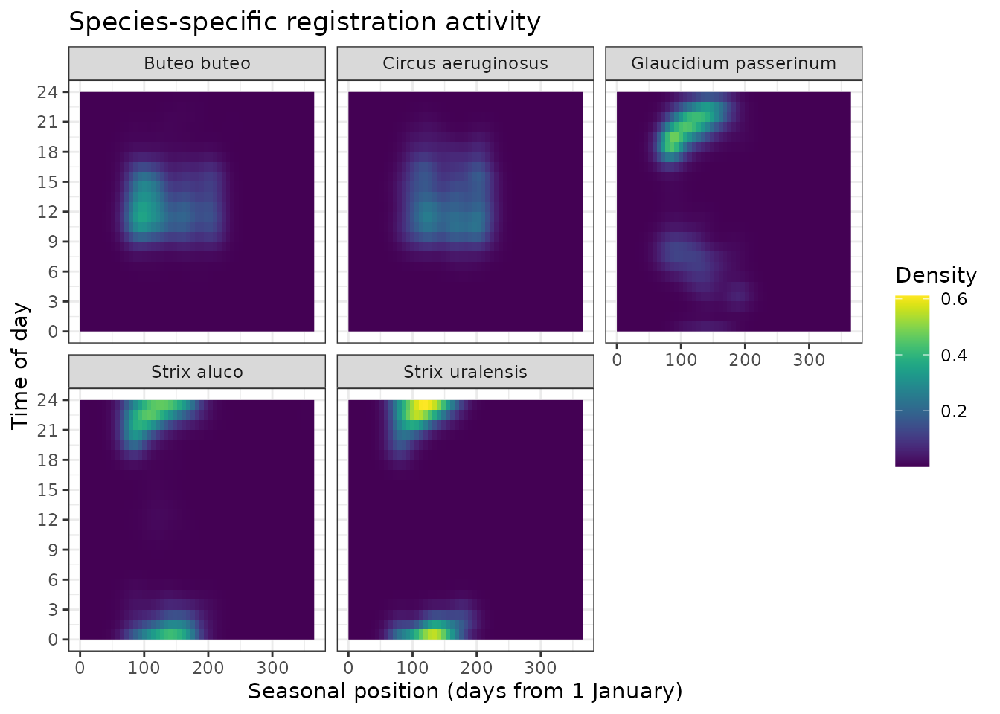
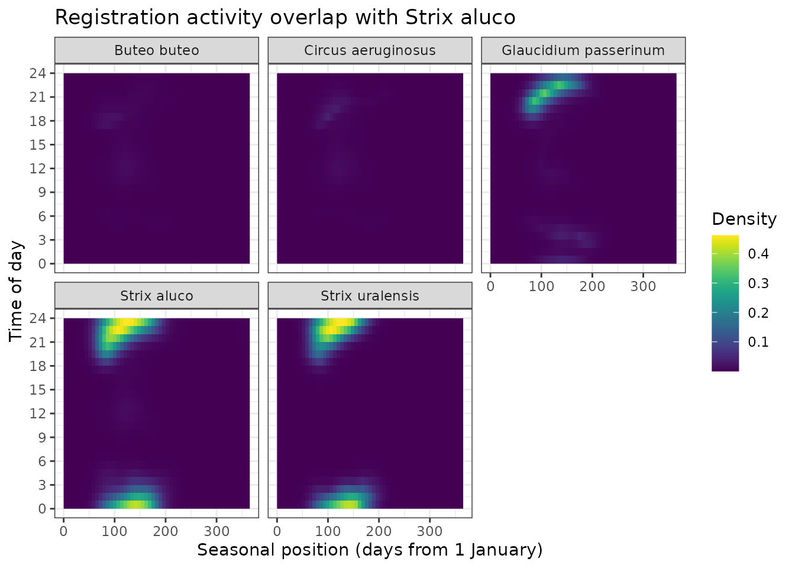

# Introduction to sdmhelpers

## Overview

`sdmhelpers` provides helper functions for species distribution
modelling (SDM) workflows, with particular emphasis on
presence-background models implemented with `maxnet`. The package
contains tools for constructing sampling-bias surfaces from target-group
records, weighting target-group observations by seasonal or combined
seasonal and diel overlap, selecting complete spatial folds for
independent testing, screening environmental predictors, and evaluating
predictions using the True Skill Statistic (TSS).

Presence-only SDMs are sensitive to differences between the sampling
process that generated species observations and the process used to
select background locations. A commonly used approach is therefore to
select or weight background data so that they reflect similar sampling
bias to the presence data ([Phillips et al. 2009](#ref-phillips2009);
[Elith et al. 2011](#ref-elith2011)). `sdmhelpers` extends this idea by
allowing records from a target group to contribute unequally according
to their temporal similarity to the focal species.

The examples below use datasets distributed with `sdmhelpers`. They are
reduced or pseudonymised datasets intended for demonstrating package
functionality, not for biological inference.

`sdmhelpers` was developed as part of the project *HiQBioDiv:
High-resolution quantification of biodiversity for conservation and
management*, funded by the Latvian Council of Science (Ref.
No. VPP-VARAM-DABA-2024/1-0002).

The development version can be installed from GitHub with:

``` r

# install.packages("remotes")
remotes::install_github("aavotins/sdmhelpers")
```

Packages used in this vignette:

``` r

library(sdmhelpers)
library(sf)
#> Linking to GEOS 3.12.1, GDAL 3.8.4, PROJ 9.4.0; sf_use_s2() is TRUE
library(ggplot2)
library(terra)
#> terra 1.9.50
library(maxnet)
library(SDMtune)
#> 
#>    _____  ____   __  ___ __
#>   / ___/ / __ \ /  |/  // /_ __  __ ____   ___
#>   \__ \ / / / // /|_/ // __// / / // __ \ / _ \
#>  ___/ // /_/ // /  / // /_ / /_/ // / / //  __/
#> /____//_____//_/  /_/ \__/ \__,_//_/ /_/ \___/  version 1.3.3
#> 
#> To cite this package in publications type: citation("SDMtune").
#> 
#> Attaching package: 'SDMtune'
#> The following object is masked from 'package:maxnet':
#> 
#>     thresholds
library(ENMeval)
#> This is ENMeval version 2.0.6. 
#> For worked examples, please consult the vignette: <https://jamiemkass.github.io/ENMeval/articles/ENMeval-2.0-vignette.html>.
```

## Example data

Several example datasets are included in the package. The examples in
this vignette use bird and bryophyte observations, spatial presence and
background locations, spatial blocks, a 100-m grid, known
habitat-inventory dates, and an example environmental raster.

``` r

data("aves_small", package = "sdmhelpers")
data("bryophyta_one", package = "sdmhelpers")
data("habitat_inventories", package = "sdmhelpers")
data("points100", package = "sdmhelpers")
data("example_grid", package = "sdmhelpers")
example_grid <- terra::unwrap(example_grid)
data("example_presences", package = "sdmhelpers")
data("example_background", package = "sdmhelpers")
data("example_independent_blocks", package = "sdmhelpers")
data("egv_names", package = "sdmhelpers")
```

The environmental raster used later in the vignette is stored in
`inst/extdata`.

``` r

egv_file <- system.file("extdata",
                        "example_egv.tif",
                        package = "sdmhelpers")
```

## Simple target-group bias surface

Target-group background sampling uses observations of taxa that are
expected to have been collected through a sampling process similar to
that of the focal species. If sampling effort is spatially biased,
drawing background data from the same biased sampling domain can reduce
the contrast between presence and background sampling processes
([Phillips et al. 2009](#ref-phillips2009)).

Here, one species from `aves_small` is treated as the focal species
while all species form the target group. For this example, the focal
species is chosen programmatically as the species with the largest
number of records so that the example does not depend on a particular
species name.

``` r

target_species <- names(
  sort(table(aves_small$species), decreasing = TRUE)
)[1]

target_species
#> [1] "Strix aluco"

target_group <- aves_small
```

Multiple observations can occur in the same 100-m grid cell. For the
spatial bias surface, records are therefore counted by grid cell and
supplied to
[`kde_surface()`](https://aavotins.github.io/sdmhelpers/reference/kde_surface.md)
as weights.

``` r

tg_counts <- aggregate(
  list(n_records = rep(1, nrow(target_group))),
  by = list(id100 = target_group$id100),
  FUN = sum
)

idx <- match(tg_counts$id100, points100$id)
keep <- !is.na(idx)

tg_points <- points100[idx[keep], ]
tg_points$n_records <- tg_counts$n_records[keep]

tg_points
#> Simple feature collection with 1065 features and 7 fields
#> Geometry type: POINT
#> Dimension:     XY
#> Bounding box:  xmin: 459750 ymin: 285250 xmax: 519650 ymax: 329550
#> Projected CRS: LKS-92 / Latvia TM
#> First 10 features:
#>                     id yes tks50km rinda300       ID1km rinda500
#> 1714235 100mX4597Y3042   1    4221   385184 1kmX459Y304   236094
#> 1714987 100mX4598Y3044   1    4221   386590 1kmX459Y304   236995
#> 1719476 100mX4604Y3043   1    4221   386592 1kmX460Y304   236096
#> 1719478 100mX4604Y3045   1    4221   386592 1kmX460Y304   236996
#> 1723202 100mX4609Y3038   1    4221   383781 1kmX460Y303   235197
#> 1723204 100mX4609Y3040   1    4221   385188 1kmX460Y304   236097
#> 1723921 100mX4610Y3013   1    4221   372533 1kmX461Y301   230697
#> 1723922 100mX4610Y3014   1    4221   372533 1kmX461Y301   231597
#> 1723926 100mX4610Y3018   1    4221   373936 1kmX461Y301   231597
#> 1723950 100mX4610Y3042   1    4221   385189 1kmX461Y304   236097
#>                          geom n_records
#> 1714235 POINT (459750 304250)         1
#> 1714987 POINT (459850 304450)         1
#> 1719476 POINT (460450 304350)         1
#> 1719478 POINT (460450 304550)         1
#> 1723202 POINT (460950 303850)         1
#> 1723204 POINT (460950 304050)         2
#> 1723921 POINT (461050 301350)         1
#> 1723922 POINT (461050 301450)         3
#> 1723926 POINT (461050 301850)         2
#> 1723950 POINT (461050 304250)         1
```

[`kde_surface()`](https://aavotins.github.io/sdmhelpers/reference/kde_surface.md)
first bins point weights to the reference raster and then applies
Gaussian smoothing. This makes the calculation practical for large
rasters and large bandwidths. Kernel density estimation in general is
described by Silverman ([1986](#ref-silverman1986)).

The example grid uses EPSG:3059, whose map units are metres, so
`sigma = 3000` corresponds to a Gaussian bandwidth of 3 km. With
`normalize = "pdf"`, the resulting surface is normalised to integrate to
one and represents a probability-density-scaled surface of the spatial
distribution of target-group records. It can therefore be used as a
relative proxy sampling-bias surface for background sampling.

``` r

simple_bias <- kde_surface(
  x = tg_points,
  weight_field = "n_records",
  sigma = 3000,
  ref = example_grid,
  normalize = "pdf",
  mask = TRUE
)

options(scipen = 999)
terra::plot(simple_bias, main = "Simple target-group bias")
```


Unweighted target-group sampling-bias surface.

This simple approach assumes that every target-group record is equally
informative about the sampling process affecting the focal species. The
following sections relax that assumption.

## Phenologically weighted target-group

Species observed by the same people or recording scheme may nevertheless
have different seasonal detectability, availability, or both. A species
recorded mainly in winter, for example, may provide little information
about sampling effort relevant to a species recorded mainly during late
spring.

phenology_overlap_weights() estimates overlap between species’
day-of-year distributions using overlapping::overlap() ([Pastore and
Calcagnì 2019](#ref-pastore2019)). This approach provides compatibility
with conventional kernel-density overlap estimation ([Pastore
2018](#ref-pastore2018)). However, because day of year is treated as a
linear variable, observations near the end and beginning of the calendar
year are not considered adjacent. For species with observation periods
spanning this boundary, torus_overlap_many() provides an alternative
based on circular kernel-density estimation with constant (e.g. midday)
value for the time of day.

First, day of year is added to the bird records.

``` r

bird_dates <- aves_small
bird_dates$DoY <- as.POSIXlt(bird_dates$date)$yday + 1L

target_code <- bird_dates$code[
  match(target_species, bird_dates$species)
]

target_code
#> [1] "STRALU"
```

We then estimate phenological overlap between the focal species
(synonymous to target-species) and every species in the target-group.

``` r

phenology_weights <- phenology_overlap_weights(
  target = bird_dates,
  group = bird_dates,
  target_code = target_code,
  target_id = "code",
  group_id = "code",
  target_doy = "DoY",
  group_doy = "DoY",
  type = "2",
  min_n = 5
)

phenology_weights[
  order(phenology_weights$weight, decreasing = TRUE),
]
#>          code   overlap    weight
#> STRALU STRALU 1.0000000 0.2659064
#> GLAPAS GLAPAS 0.8256341 0.2195414
#> STRURA STRURA 0.8053464 0.2141467
#> BUTBUT BUTBUT 0.6383454 0.1697401
#> CIRAER CIRAER 0.4913965 0.1306654
```

The returned `weight` values sum to one across comparison species with
valid overlap estimates. Here, each target-group observation receives
the weight of its species. Records are then summed within 100-m cells
before KDE smoothing.

``` r

target_group_p <- merge(
  target_group,
  phenology_weights[, c("code", "weight")],
  by = "code",
  all.x = TRUE
)

target_group_p <- target_group_p[
  is.finite(target_group_p$weight) &
    !is.na(target_group_p$id100),
]

tg_weighted <- aggregate(
  list(weight = target_group_p$weight),
  by = list(id100 = target_group_p$id100),
  FUN = sum
)

idx <- match(tg_weighted$id100, points100$id)
keep <- !is.na(idx)

tg_points_weighted <- points100[idx[keep], ]
tg_points_weighted$weight <- tg_weighted$weight[keep]
```

``` r

phenology_bias <- kde_surface(
  x = tg_points_weighted,
  weight_field = "weight",
  sigma = 3000,
  ref = example_grid,
  normalize = "pdf",
  mask = TRUE
)

options(scipen = 999)
terra::plot(
  phenology_bias,
  main = "Phenologically weighted target-group bias"
)
```


Phenologically weighted target-group sampling-bias surface.

The weighted surface should be interpreted as a relative sampling-bias
surface, not as an estimate of species occurrence probability. Its
purpose is to describe where observations relevant to the focal species’
seasonal sampling process were more or less likely to have been
collected.

## Target-group weighting by seasonal and diel overlap

For taxa whose detectability varies both seasonally and through the day,
seasonal overlap alone may be insufficient.
[`torus_overlap_many()`](https://aavotins.github.io/sdmhelpers/reference/torus_overlap_many.md)
represents season and time of day as two circular dimensions and
estimates overlap on a two-dimensional torus. Circular treatment is
important because both annual and daily cycles wrap around their
endpoints; see Mardia and Jupp ([1999](#ref-mardia2000)) for directional
statistics and Ridout and Linkie ([2009](#ref-ridout2009)) for overlap
estimation of diel activity patterns.

The bird dataset contains date-time observations. For this introductory
example, we select the focal species with the largest number of valid
date-time records and compare its seasonal and diel observation
distributions with those of every species in the target group (including
the focal species itself).

``` r

comparison_data <- aves_small[
  !is.na(aves_small$date_time),
  ,
  drop = FALSE
]

target_species_torus <- names(
  sort(table(comparison_data$species), decreasing = TRUE)
)[1]

reference_data <- comparison_data[
  comparison_data$species == target_species_torus,
  ,
  drop = FALSE
]

reference_data$obs_date <- as.Date(reference_data$date_time)
reference_data$obs_time <- hms::as_hms(reference_data$date_time)

comparison_data$obs_date <- as.Date(comparison_data$date_time)
comparison_data$obs_time <- hms::as_hms(comparison_data$date_time)
```

For speed, the example uses a coarser evaluation grid than would often
be used in a final analysis.

``` r

torus_result <- torus_overlap_many(
  reference_data = reference_data,
  comparison_data = comparison_data,
  comparison_group_col = "species",
  reference_date_col = "obs_date",
  reference_time_col = "obs_time",
  comparison_date_col = "obs_date",
  comparison_time_col = "obs_time",
  reference_name = target_species_torus,
  season_bw_days = 14,
  daily_bw_hours = 1,
  date_resolution_days = 7,
  time_resolution_minutes = 60,
  min_n = 5,
  return_density = FALSE
)

torus_overlap <- torus_result$overlap
torus_overlap <- torus_overlap[
  order(torus_overlap$overlap, decreasing = TRUE),
]

head(torus_overlap, 10)
#>     reference            comparison n_reference n_comparison    overlap status
#> 4 Strix aluco           Strix aluco        3004         3004 1.00000000     OK
#> 5 Strix aluco       Strix uralensis        3004          137 0.86931899     OK
#> 3 Strix aluco Glaucidium passerinum        3004          330 0.41910228     OK
#> 2 Strix aluco    Circus aeruginosus        3004          671 0.04184691     OK
#> 1 Strix aluco           Buteo buteo        3004         2095 0.03477199     OK
```

The overlap coefficient ranges from zero to one for normalised
densities. A large value indicates that a comparison species has a
seasonal-diel observation distribution similar to the focal species.

To use these coefficients as relative species weights in a target group,
they can be normalised across comparison species.

``` r

ok <- is.finite(torus_overlap$overlap)

torus_overlap$weight <- NA_real_
torus_overlap$weight[ok] <-
  torus_overlap$overlap[ok] /
  sum(torus_overlap$overlap[ok])

head(
  torus_overlap[
    order(torus_overlap$weight, decreasing = TRUE),
    c("comparison", "overlap", "weight")
  ],
  10
)
#>              comparison    overlap     weight
#> 4           Strix aluco 1.00000000 0.42282580
#> 5       Strix uralensis 0.86931899 0.36757050
#> 3 Glaucidium passerinum 0.41910228 0.17720726
#> 2    Circus aeruginosus 0.04184691 0.01769395
#> 1           Buteo buteo 0.03477199 0.01470250
```

These weights can be joined back to the individual observations and
passed to
[`kde_surface()`](https://aavotins.github.io/sdmhelpers/reference/kde_surface.md)
in exactly the same way as the phenological weights above.

The overlap can also be visualised, when setting `return_density = TRUE`

``` r

torus_result <- torus_overlap_many(
  reference_data = reference_data,
  comparison_data = comparison_data,
  comparison_group_col = "species",
  reference_date_col = "obs_date",
  reference_time_col = "obs_time",
  comparison_date_col = "obs_date",
  comparison_time_col = "obs_time",
  reference_name = target_species_torus,
  season_bw_days = 14,
  daily_bw_hours = 1,
  date_resolution_days = 7,
  time_resolution_minutes = 60,
  min_n = 5,
  return_density = TRUE
)

ggplot(torus_result$density,
       aes(
         x = seasonal_position_days,
         y = decimal_hour,
         fill = comparison_density
         )
       ) +
  geom_raster() +
  facet_wrap(~ comparison) +
  scale_y_continuous(breaks = seq(0, 24, by = 3)) +
  viridis::scale_fill_viridis() +
  labs(
    x = "Seasonal position (days from 1 January)",
       y = "Time of day",
       fill = "Density",
       title = "Species-specific registration activity") +
  theme_bw()
```



``` r


ggplot(torus_result$density,
       aes(
         x = seasonal_position_days,
         y = decimal_hour,
         fill = shared_density
         )
       ) +
  geom_raster() +
  facet_wrap(~ comparison) +
  scale_y_continuous(breaks = seq(0, 24, by = 3)) +
  viridis::scale_fill_viridis() +
  labs(x = "Seasonal position (days from 1 January)",
       y = "Time of day",
       fill = "Density",
       title = paste0(
         "Registration activity overlap with ", 
         target_species_torus
         )
       ) +
  theme_bw()
```



## Known inventory dates

Sometimes the dates of a survey or habitat inventory are known, while
the species itself was not necessarily recorded during that survey. In
this case,
[`doy_kde_weights()`](https://aavotins.github.io/sdmhelpers/reference/doy_kde_weights.md)
can estimate how closely each inventory date corresponds to the seasonal
registration-activity distribution of a target species.

The function estimates a circular approximation to a day-of-year KDE
from the reference dates and evaluates that density at another set of
dates. Circularity is approximated by periodically extending the
reference observations across the seasonal boundary, which reduces
boundary effects between observations near the end and beginning of the
year. Bandwidth controls the degree of smoothing, as in conventional KDE
([Silverman 1986](#ref-silverman1986)).

The example below uses one bryophyte species considered to be an
old-growth forest specialist and therefore specifically searched for
during habitat inventories.

``` r

bryophyta_species <- names(
  sort(table(bryophyta_one$species), decreasing = TRUE)
)[1]

reference_dates <- bryophyta_one$date[
  bryophyta_one$species == bryophyta_species &
    !is.na(bryophyta_one$date)
]

inventory_keep <- !is.na(habitat_inventories$date)

inventory_weights <- doy_kde_weights(
  A_dates = reference_dates,
  B_dates = habitat_inventories$date[inventory_keep],
  scale = "percentile_A",
  bw = "nrd0"
)

weighted_inventories <- habitat_inventories[inventory_keep, ]
weighted_inventories$phenology_weight <- inventory_weights$weights
```

With `scale = "percentile_A"`, weights describe how high the estimated
reference density is relative to density values across the seasonal
cycle. They are relative phenological correspondence scores rather than
occurrence probabilities.

``` r

aggregate(
  phenology_weight ~ habitat_type,
  data = weighted_inventories,
  FUN = mean
)
#>   habitat_type phenology_weight
#> 1         dune        0.7492080
#> 2       forest        0.7281414
#> 3   freshwater        0.6848989
#> 4    grassland        0.6864115
#> 5      heather        0.0630137
#> 6         mire        0.6161949
```

The estimated seasonal reference curve can also be inspected directly.

``` r

plot(
  inventory_weights$density$x,
  inventory_weights$density$y,
  type = "l",
  xlab = "Day of year",
  ylab = "Estimated reference density"
)
```


Estimated seasonal registration-activity curve used for weighting known
inventory dates.

## Selecting an independent testing set

Random train-test splitting can give overly optimistic estimates of
predictive performance when nearby observations are spatially dependent.
Spatially structured resampling is therefore generally preferable when
the intended prediction involves geographic transfer ([Roberts et al.
2017](#ref-roberts2017)).

`sdmhelpers` does not define the spatial blocks themselves. Instead,
[`select_folds_by_quota()`](https://aavotins.github.io/sdmhelpers/reference/select_folds_by_quota.md)
and
[`select_joint_folds()`](https://aavotins.github.io/sdmhelpers/reference/select_joint_folds.md)
select complete groups from fold identifiers created elsewhere.
Independence therefore comes from the design of the folds, not from the
selection function.

The package contains example presence records, background records, and
independent spatial polygons.

``` r

pres_sf <- sf::st_as_sf(
  example_presences,
  coords = c("x", "y"),
  crs = 3059
)

bg_sf <- sf::st_as_sf(
  example_background,
  coords = c("x", "y"),
  crs = 3059
)

block_id <- setdiff(
  names(example_independent_blocks),
  attr(example_independent_blocks, "sf_column")
)[1]

pres_joined <- sf::st_join(
  pres_sf,
  example_independent_blocks[block_id],
  join = sf::st_within,
  left = TRUE
)

bg_joined <- sf::st_join(
  bg_sf,
  example_independent_blocks[block_id],
  join = sf::st_within,
  left = TRUE
)

pres_folds <- pres_joined[[block_id]]
bg_folds <- bg_joined[[block_id]]
```

When both presences and background should be withheld from the same
spatial blocks,
[`select_joint_folds()`](https://aavotins.github.io/sdmhelpers/reference/select_joint_folds.md)
is convenient.

``` r

independent <- select_joint_folds(
  pres_folds = pres_folds,
  bg_folds = bg_folds,
  target_prop = 0.25,
  pres_bounds = c(0.20, 0.30),
  bg_bounds = c(0.20, 0.30),
  max_tries = 3000,
  bg_match_weight = 1,
  seed = 1,
  print_report = FALSE
)

independent$selected_fold_ids
#>   [1] "110" "117" "142" "153" "183" "186" "197" "208" "252" "280" "282" "291"
#>  [13] "312" "323" "325" "340" "343" "353" "354" "380" "392" "397" "398" "4"  
#>  [25] "406" "407" "411" "413" "421" "433" "434" "44"  "441" "459" "464" "475"
#>  [37] "479" "490" "506" "511" "515" "516" "518" "519" "521" "523" "536" "537"
#>  [49] "539" "543" "548" "553" "572" "590" "600" "606" "610" "613" "629" "631"
#>  [61] "641" "643" "644" "645" "646" "647" "661" "670" "671" "675" "677" "68" 
#>  [73] "686" "697" "70"  "703" "712" "715" "717" "722" "732" "734" "738" "749"
#>  [85] "83"  "95"  "100" "101" "103" "104" "11"  "116" "12"  "124" "125" "126"
#>  [97] "130" "144" "145" "147" "149" "152" "155" "18"  "180" "192" "194" "198"
#> [109] "2"   "201" "203" "211" "220" "228" "232" "237" "238" "242" "247" "255"
#> [121] "26"  "262" "28"  "287" "288" "289" "29"  "292" "295" "3"   "30"  "326"
#> [133] "328" "330" "341" "347" "350" "352" "36"  "363" "369" "375" "379" "388"
#> [145] "394" "402" "408" "42"  "436" "438" "447" "453" "456" "457" "462" "463"
#> [157] "466" "482" "494" "495" "500" "525" "534" "540" "560" "564" "568" "571"
#> [169] "575" "58"  "593" "596" "597" "598" "599" "60"  "612" "617" "618" "634"
#> [181] "636" "64"  "640" "649" "658" "66"  "662" "664" "665" "666" "667" "676"
#> [193] "684" "693" "694" "696" "7"   "721" "741" "75"  "78"  "8"   "9"   "91" 
#> [205] "93"  "98"
independent$summary[c(
  "n_pres_selected",
  "n_bg_selected",
  "prop_pres_selected",
  "prop_bg_selected"
)]
#> $n_pres_selected
#> 295 
#> 694 
#> 
#> $n_bg_selected
#>  295 
#> 9957 
#> 
#> $prop_pres_selected
#>     295 
#> 0.24991 
#> 
#> $prop_bg_selected
#>       295 
#> 0.2499122
```

The returned logical vectors preserve the row order of the input data
and can be used directly for subsetting.

``` r

pres_test <- example_presences[independent$pres_selected_idx, ]
pres_train <- example_presences[!independent$pres_selected_idx, ]

bg_test <- example_background[independent$bg_selected_idx, ]
bg_train <- example_background[!independent$bg_selected_idx, ]

c(
  pres_train = nrow(pres_train),
  pres_test = nrow(pres_test),
  bg_train = nrow(bg_train),
  bg_test = nrow(bg_test)
)
#> pres_train  pres_test   bg_train    bg_test 
#>       2084        694      30043       9957
```

If only one type of observation needs to be selected, the simpler
[`select_folds_by_quota()`](https://aavotins.github.io/sdmhelpers/reference/select_folds_by_quota.md)
can be used instead.

``` r

presence_only_selection <- select_folds_by_quota(
  folds = pres_folds,
  target_prop = 0.25,
  bounds = c(0.20, 0.30),
  seed = 1,
  print_report = FALSE
)

presence_only_selection$summary$prop_selected
#> [1] 0.299964
```

## Screening predictor variance

Predictors that are constant across all data used for model fitting
cannot provide an estimable environmental response. Low variance within
an individual subset, however, does not necessarily imply that a
predictor is uninformative: for example, a predictor may be constant
among presences but variable among background records.
[`screen_egv_variance()`](https://aavotins.github.io/sdmhelpers/reference/screen_egv_variance.md)
therefore distinguishes the presence, background, and combined-data
checks and records which checks contribute to predictor selection.

The example environmental raster contains five ecogeographical
variables. The presence and background locations were split spatially
into independent training and testing sets in the preceding section.

``` r

env <- terra::rast(egv_file)
env
#> class       : SpatRaster
#> size        : 650, 650, 5  (nrow, ncol, nlyr)
#> resolution  : 100, 100  (x, y)
#> extent      : 455000, 520000, 280000, 345000  (xmin, xmax, ymin, ymax)
#> coord. ref. : LKS-92 / Latvia TM (EPSG:3059)
#> source      : example_egv.tif
#> names       :   egv_280,   egv_293,   egv_302,   egv_385,   egv_400
#> min values  : -0.466794, -0.719917, -0.397964, -1.461203,  -0.37327
#> max values  :   3.70894,  7.054723,  8.359298,  5.206886, 11.300995
```

We first prepare the training and independent-testing datasets **once**,
using the same environmental predictors.
[`SDMtune::prepareSWD()`](https://consbiol-unibern.github.io/SDMtune/reference/prepareSWD.html)
removes locations with missing values in any supplied environmental
layer. Many example records fall outside the raster’s complete-data
domain; the counts below show how many observations remain after
extraction. All subsequent checks, fold assignments, model fitting, and
evaluation use these retained records.

``` r

training_set <- SDMtune::prepareSWD(
  species = "example_species",
  p = pres_train,
  a = bg_train,
  env = env,
  verbose = FALSE
)
#> Warning: ! 2009 locations are NA for some environmental variables and have been
#>   discarded
#> Warning: ! 28679 locations are NA for some environmental variables and have been
#>   discarded

testing_set <- SDMtune::prepareSWD(
  species = "example_species",
  p = pres_test,
  a = bg_test,
  env = env,
  verbose = FALSE
)
#> Warning: ! 613 locations are NA for some environmental
#> variables and have been discarded
#> Warning: ! 8890 locations are NA for some environmental variables and have been
#>   discarded

c(
  training_presences = sum(training_set@pa == 1),
  training_background = sum(training_set@pa == 0),
  testing_presences = sum(testing_set@pa == 1),
  testing_background = sum(testing_set@pa == 0)
)
#>  training_presences training_background   testing_presences  testing_background 
#>                  75                1364                  81                1067
```

For spatial cross-validation, we assign folds **after** the
environmental-value extraction so that the fold identifiers correspond
exactly to rows in the training `SWD` object.
[`ENMeval::get.block()`](https://jamiemkass.github.io/ENMeval/reference/partitions.html)
expects longitude-latitude coordinates; the projected EPSG:3059
coordinates are therefore converted to EPSG:4326 solely for constructing
the folds. This does not change the predictor values stored in
`training_set`.

``` r

as_lonlat <- function(coords) {
  pts <- sf::st_as_sf(
    coords,
    coords = c("X", "Y"),
    crs = 3059
  )
  ll <- sf::st_coordinates(sf::st_transform(pts, 4326))
  data.frame(lon = ll[, 1], lat = ll[, 2])
}

pres_idx <- training_set@pa == 1
bg_idx <- training_set@pa == 0

block_folds <- ENMeval::get.block(
  occs = as_lonlat(training_set@coords[pres_idx, , drop = FALSE]),
  bg = as_lonlat(training_set@coords[bg_idx, , drop = FALSE])
)
```

The screen checks presences, backgrounds, and their combination both
across all training records and within each cross-validation training
partition. Because `bg_folds` is supplied, the corresponding held-out
background fold is excluded as well as the presence fold. Presence-only
checks are retained as diagnostics but do not automatically remove
predictors. The independent test set can also be diagnosed, while the
default leakage-safe settings ensure that its values do not affect
`keep` or `remove`.

``` r

variance_screen <- screen_egv_variance(
  train = training_set,
  test = testing_set,
  occ_folds = block_folds$occs.grp,
  bg_folds = block_folds$bg.grp,
  env = env,
  env_sample_n = 5000L,
  seed = 1L,
  sd_tol = 0,
  check_presences = TRUE,
  check_background = TRUE,
  check_combined = TRUE,
  presence_affects_selection = FALSE,
  include_test_bg = FALSE,
  check_test = TRUE,
  test_affects_selection = FALSE,
  verbose = FALSE
)

variance_screen$keep
#> [1] "egv_280" "egv_293" "egv_302" "egv_385" "egv_400"
variance_screen$remove
#> character(0)
```

A predictor is removed only if it fails at least one check marked
`used_for_selection = TRUE`. A failed diagnostic-only check remains
visible in `diagnostics` but does not affect predictor selection. Even
though this example calculates diagnostic-only checks on the independent
test, their results must not be used to revise the chosen predictor set
or model. In a final analysis, it is preferable not to inspect the
held-out test diagnostics until the model specification has been fixed.

``` r

head(variance_screen$diagnostics)
#>      check subset data_source      group fold used_for_selection variable
#> 1 training    all    training  presences <NA>              FALSE  egv_280
#> 2 training    all    training  presences <NA>              FALSE  egv_293
#> 3 training    all    training  presences <NA>              FALSE  egv_302
#> 4 training    all    training  presences <NA>              FALSE  egv_385
#> 5 training    all    training  presences <NA>              FALSE  egv_400
#> 6 training    all    training background <NA>               TRUE  egv_280
#>   n_finite        sd failed reason
#> 1       75 1.5562103  FALSE passed
#> 2       75 1.8404706  FALSE passed
#> 3       75 1.1651248  FALSE passed
#> 4       75 0.4201842  FALSE passed
#> 5       75 0.4363026  FALSE passed
#> 6     1364 1.5236134  FALSE passed

subset(
  variance_screen$diagnostics,
  failed & !used_for_selection,
  select = c(check, subset, group, variable, sd, reason)
)
#> [1] check    subset   group    variable sd       reason  
#> <0 rows> (or 0-length row.names)
```

The random environmental-domain check samples raster cells independently
of the observed training background locations. It does **not** resample
the background records already contained in `training_set`.

A common predictor set screened across all CV partitions is convenient
for this introductory example. For an unbiased assessment of a pipeline
that selects predictors anew, that selection must instead be performed
separately inside each CV training partition.

``` r

subset(
  variance_screen$diagnostics,
  check == "cv_training",
  select = c(
    check, subset, group, fold,
    variable, sd, failed, used_for_selection
  )
)
#>          check          subset      group fold variable        sd failed
#> 16 cv_training held_out_fold_2  presences    2  egv_280 1.5974080  FALSE
#> 17 cv_training held_out_fold_2  presences    2  egv_293 1.7213387  FALSE
#> 18 cv_training held_out_fold_2  presences    2  egv_302 1.1385672  FALSE
#> 19 cv_training held_out_fold_2  presences    2  egv_385 0.3446358  FALSE
#> 20 cv_training held_out_fold_2  presences    2  egv_400 0.1296358  FALSE
#> 21 cv_training held_out_fold_2 background    2  egv_280 1.5930103  FALSE
#> 22 cv_training held_out_fold_2 background    2  egv_293 1.6918404  FALSE
#> 23 cv_training held_out_fold_2 background    2  egv_302 1.5554488  FALSE
#> 24 cv_training held_out_fold_2 background    2  egv_385 0.4753539  FALSE
#> 25 cv_training held_out_fold_2 background    2  egv_400 0.4171508  FALSE
#> 26 cv_training held_out_fold_2   combined    2  egv_280 1.6497089  FALSE
#> 27 cv_training held_out_fold_2   combined    2  egv_293 1.8766848  FALSE
#> 28 cv_training held_out_fold_2   combined    2  egv_302 1.5449395  FALSE
#> 29 cv_training held_out_fold_2   combined    2  egv_385 0.4672986  FALSE
#> 30 cv_training held_out_fold_2   combined    2  egv_400 0.4049559  FALSE
#> 31 cv_training held_out_fold_4  presences    4  egv_280 1.6395785  FALSE
#> 32 cv_training held_out_fold_4  presences    4  egv_293 1.8506224  FALSE
#> 33 cv_training held_out_fold_4  presences    4  egv_302 1.1297366  FALSE
#> 34 cv_training held_out_fold_4  presences    4  egv_385 0.4651644  FALSE
#> 35 cv_training held_out_fold_4  presences    4  egv_400 0.4948771  FALSE
#> 36 cv_training held_out_fold_4 background    4  egv_280 1.5366295  FALSE
#> 37 cv_training held_out_fold_4 background    4  egv_293 1.6757226  FALSE
#> 38 cv_training held_out_fold_4 background    4  egv_302 1.5804242  FALSE
#> 39 cv_training held_out_fold_4 background    4  egv_385 0.8740921  FALSE
#> 40 cv_training held_out_fold_4 background    4  egv_400 0.9401085  FALSE
#> 41 cv_training held_out_fold_4   combined    4  egv_280 1.5906969  FALSE
#> 42 cv_training held_out_fold_4   combined    4  egv_293 1.8192609  FALSE
#> 43 cv_training held_out_fold_4   combined    4  egv_302 1.5794229  FALSE
#> 44 cv_training held_out_fold_4   combined    4  egv_385 0.8570493  FALSE
#> 45 cv_training held_out_fold_4   combined    4  egv_400 0.9198140  FALSE
#> 46 cv_training held_out_fold_3  presences    3  egv_280 1.5176560  FALSE
#> 47 cv_training held_out_fold_3  presences    3  egv_293 1.7655457  FALSE
#> 48 cv_training held_out_fold_3  presences    3  egv_302 1.2211444  FALSE
#> 49 cv_training held_out_fold_3  presences    3  egv_385 0.3984288  FALSE
#> 50 cv_training held_out_fold_3  presences    3  egv_400 0.4954987  FALSE
#> 51 cv_training held_out_fold_3 background    3  egv_280 1.4932623  FALSE
#> 52 cv_training held_out_fold_3 background    3  egv_293 1.5232976  FALSE
#> 53 cv_training held_out_fold_3 background    3  egv_302 1.5333896  FALSE
#> 54 cv_training held_out_fold_3 background    3  egv_385 0.7893809  FALSE
#> 55 cv_training held_out_fold_3 background    3  egv_400 0.8197605  FALSE
#> 56 cv_training held_out_fold_3   combined    3  egv_280 1.5475879  FALSE
#> 57 cv_training held_out_fold_3   combined    3  egv_293 1.6529372  FALSE
#> 58 cv_training held_out_fold_3   combined    3  egv_302 1.5358597  FALSE
#> 59 cv_training held_out_fold_3   combined    3  egv_385 0.7766520  FALSE
#> 60 cv_training held_out_fold_3   combined    3  egv_400 0.8083519  FALSE
#> 61 cv_training held_out_fold_1  presences    1  egv_280 1.4495707  FALSE
#> 62 cv_training held_out_fold_1  presences    1  egv_293 1.9947205  FALSE
#> 63 cv_training held_out_fold_1  presences    1  egv_302 1.1715437  FALSE
#> 64 cv_training held_out_fold_1  presences    1  egv_385 0.4494924  FALSE
#> 65 cv_training held_out_fold_1  presences    1  egv_400 0.4938591  FALSE
#> 66 cv_training held_out_fold_1 background    1  egv_280 1.4944325  FALSE
#> 67 cv_training held_out_fold_1 background    1  egv_293 1.5744318  FALSE
#> 68 cv_training held_out_fold_1 background    1  egv_302 1.5523231  FALSE
#> 69 cv_training held_out_fold_1 background    1  egv_385 0.7867514  FALSE
#> 70 cv_training held_out_fold_1 background    1  egv_400 0.8016187  FALSE
#> 71 cv_training held_out_fold_1   combined    1  egv_280 1.5491069  FALSE
#> 72 cv_training held_out_fold_1   combined    1  egv_293 1.7091390  FALSE
#> 73 cv_training held_out_fold_1   combined    1  egv_302 1.5552666  FALSE
#> 74 cv_training held_out_fold_1   combined    1  egv_385 0.7753450  FALSE
#> 75 cv_training held_out_fold_1   combined    1  egv_400 0.7909909  FALSE
#>    used_for_selection
#> 16              FALSE
#> 17              FALSE
#> 18              FALSE
#> 19              FALSE
#> 20              FALSE
#> 21               TRUE
#> 22               TRUE
#> 23               TRUE
#> 24               TRUE
#> 25               TRUE
#> 26               TRUE
#> 27               TRUE
#> 28               TRUE
#> 29               TRUE
#> 30               TRUE
#> 31              FALSE
#> 32              FALSE
#> 33              FALSE
#> 34              FALSE
#> 35              FALSE
#> 36               TRUE
#> 37               TRUE
#> 38               TRUE
#> 39               TRUE
#> 40               TRUE
#> 41               TRUE
#> 42               TRUE
#> 43               TRUE
#> 44               TRUE
#> 45               TRUE
#> 46              FALSE
#> 47              FALSE
#> 48              FALSE
#> 49              FALSE
#> 50              FALSE
#> 51               TRUE
#> 52               TRUE
#> 53               TRUE
#> 54               TRUE
#> 55               TRUE
#> 56               TRUE
#> 57               TRUE
#> 58               TRUE
#> 59               TRUE
#> 60               TRUE
#> 61              FALSE
#> 62              FALSE
#> 63              FALSE
#> 64              FALSE
#> 65              FALSE
#> 66               TRUE
#> 67               TRUE
#> 68               TRUE
#> 69               TRUE
#> 70               TRUE
#> 71               TRUE
#> 72               TRUE
#> 73               TRUE
#> 74               TRUE
#> 75               TRUE
```

## Fitting a small maxnet model

`sdmhelpers` supports rather than replaces SDM software. Here we fit a
small illustrative `maxnet` model to the training data using **only the
predictors retained by the variance screen**. This model is for
demonstration; the cross-validation example below can be used to compare
alternative feature classes and regularisation multipliers before
fitting a final model.

``` r

selected_vars <- variance_screen$keep

if (!length(selected_vars)) {
  stop("No predictors passed variance screening.")
}

maxnet_model <- maxnet::maxnet(
  p = training_set@pa,
  data = training_set@data[, selected_vars, drop = FALSE],
  addsamplestobackground = TRUE
)
```

Following the conventional Maxent approach, presence locations not
already represented in the background are additionally included as
background samples during model fitting. This behaviour is enabled by
`addsamplestobackground = TRUE`, which is also the default in `maxnet`.

We do not separately call
[`SDMtune::addSamplesToBg()`](https://consbiol-unibern.github.io/SDMtune/reference/addSamplesToBg.html)
because `maxnet` handles this operation internally. Consequently, the
original `training_set` object remains unchanged, and its presence and
background records can be used consistently for subsequent evaluation
and cross-validation.

Importantly, this operation uses only the training data. Independent
testing presences and background records remain withheld from model
fitting.

## Evaluating models with TSS

The true skill statistic (TSS) is defined as

\\ \mathrm{TSS} = \mathrm{sensitivity} + \mathrm{specificity} - 1. \\

[`max_tss()`](https://aavotins.github.io/sdmhelpers/reference/max_tss.md)
evaluates candidate thresholds and returns the threshold that maximizes
TSS, together with sensitivity and specificity. For presence-background
data, background locations are not confirmed absences; thus the reported
specificity is the proportion of background records classified as
negative, and TSS should be interpreted as presence-background
discrimination rather than classification accuracy against known
absences ([Allouche et al. 2006](#ref-allouche2006)).

Critically, selecting a threshold using independent-test predictions and
then reporting TSS on that same test set would yield a test-optimized
estimate. Here we select the threshold using **training predictions
only**, and then apply it unchanged to the withheld independent test.
The resulting independent-test TSS is not optimized on test labels,
although the threshold chosen on fitting data may be optimistic for the
training sample itself.

``` r

train_p_pos <- predict(
  maxnet_model,
  newdata = training_set@data[
    training_set@pa == 1, selected_vars, drop = FALSE
  ],
  type = "cloglog"
)

train_p_bg <- predict(
  maxnet_model,
  newdata = training_set@data[
    training_set@pa == 0, selected_vars, drop = FALSE
  ],
  type = "cloglog"
)

training_tss <- max_tss(p_pos = train_p_pos, p_neg = train_p_bg)
threshold <- unname(training_tss["threshold"])
training_tss
#>         tss   threshold sensitivity specificity 
#>   0.7227370   0.1993446   0.9866667   0.7360704
```

``` r

test_p_pos <- predict(
  maxnet_model,
  newdata = testing_set@data[
    testing_set@pa == 1, selected_vars, drop = FALSE
  ],
  type = "cloglog"
)

test_p_bg <- predict(
  maxnet_model,
  newdata = testing_set@data[
    testing_set@pa == 0, selected_vars, drop = FALSE
  ],
  type = "cloglog"
)

independent_sensitivity <- mean(test_p_pos >= threshold)
independent_background_specificity <- mean(test_p_bg < threshold)

c(
  threshold_from_training = threshold,
  sensitivity = independent_sensitivity,
  background_specificity = independent_background_specificity,
  independent_TSS = independent_sensitivity +
    independent_background_specificity - 1
)
#> threshold_from_training             sensitivity  background_specificity 
#>               0.1993446               0.9012346               0.6269916 
#>         independent_TSS 
#>               0.5282261
```

The same threshold can be applied to predictions at raster cells when a
binary suitability map is needed. For an independent final evaluation,
the threshold and all predictor-selection and tuning decisions should be
fixed before the held-out test predictions are examined.

## Cross-validation TSS with ENMeval

The independent testing set created earlier is reserved for the final
assessment of the fitted model. Model tuning instead uses spatial
cross-validation of the training data, keeping the independent testing
set out of predictor-selection and tuning decisions. Spatial resampling
can reduce dependence between model calibration and validation
observations when the intended prediction involves geographic transfer
([Roberts et al. 2017](#ref-roberts2017)).

`ENMeval` supports spatial partitions and multiple complexity settings
for Maxent and `maxnet` models ([Muscarella et al.
2014](#ref-muscarella2014); [Kass et al. 2021](#ref-kass2021)). We reuse
the four presence and background fold assignments (`block_folds`)
created in the predictor-screening section. These were calculated using
the records remaining in `training_set` after environmental values were
extracted, so their ordering matches the model inputs. There is no need
to generate a second set of folds.

For illustration, we compare three feature-class settings (linear, `L`;
quadratic, `Q`; and linear plus quadratic, `LQ`) and three
regularisation multipliers (0.5, 1, and 2). The regularisation
multiplier controls the strength of model penalisation; thus, nine
candidate settings are evaluated.

**Important:** The predictor set used below is the one returned by
[`screen_egv_variance()`](https://aavotins.github.io/sdmhelpers/reference/screen_egv_variance.md)
in the preceding section. It is held constant across the candidate model
settings for this introductory example.

``` r

selected_vars <- variance_screen$keep

if (length(selected_vars) == 0L) {
  stop("No predictors passed variance screening.")
}

pres_idx <- training_set@pa == 1
bg_idx <- training_set@pa == 0

# The as_lonlat() helper and block_folds were defined in the preceding section.
# ENMeval receives coordinates in the first two columns, followed by predictors.
presences <- cbind(
  as_lonlat(training_set@coords[pres_idx, , drop = FALSE]),
  training_set@data[pres_idx, selected_vars, drop = FALSE]
)

background <- cbind(
  as_lonlat(training_set@coords[bg_idx, , drop = FALSE]),
  training_set@data[bg_idx, selected_vars, drop = FALSE]
)

stopifnot(
  length(block_folds$occs.grp) == nrow(presences),
  length(block_folds$bg.grp) == nrow(background)
)
```

Following the conventional Maxent approach, occurrence locations are
additionally included among the background samples used for model
fitting by setting `addsamplestobackground = TRUE`. This behavior is the
default in both `maxnet` and ENMeval’s Maxnet implementation. During
spatial cross-validation, only the training data for each partition
should contribute to model fitting, while validation presences and
backgrounds remain withheld for evaluation. The option
`validation.bg = "partition"` additionally restricts validation
comparisons to the background records assigned to the corresponding
validation partition.

``` r

enmeval_result <- ENMeval::ENMevaluate(
  occs = presences,
  bg = background,
  algorithm = "maxnet",
  partitions = "user",
  user.grp = list(
    occs.grp = block_folds$occs.grp,
    bg.grp = block_folds$bg.grp
  ),
  tune.args = list(
    fc = c("L", "Q", "LQ"),
    rm = c(0.5, 1, 2)
  ),
  other.settings = list(
    validation.bg = "partition",
    addsamplestobackground = TRUE
  ),
  user.eval = tss_user_eval
)
#>   |                                                                              |                                                                      |   0%  |                                                                              |========                                                              |  11%  |                                                                              |================                                                      |  22%  |                                                                              |=======================                                               |  33%  |                                                                              |===============================                                       |  44%  |                                                                              |=======================================                               |  56%  |                                                                              |===============================================                       |  67%  |                                                                              |======================================================                |  78%  |                                                                              |==============================================================        |  89%  |                                                                              |======================================================================| 100%
```

The `user.eval = tss_user_eval` argument adds the package’s custom TSS
calculations. For each candidate model and cross-validation fold,
`ENMeval` supplies predictions for training and validation occurrences
and background records.
[`tss_user_eval()`](https://aavotins.github.io/sdmhelpers/reference/tss_user_eval.md)
applies
[`max_tss()`](https://aavotins.github.io/sdmhelpers/reference/max_tss.md)
separately to the training and validation predictions. Its fold-level
output includes maximum validation TSS (`tss.val`), the corresponding
validation threshold (`thr.val`), sensitivity (`sens.val`),
background-based specificity (`spec.val`), and maximum training TSS
(`tss.train`).

In presence-background models, background locations are not confirmed
absences. Consequently, `spec.val` is the proportion of background
predictions below the selected threshold, not specificity estimated
using verified absences.

**Interpretation of threshold optimisation.** Since `thr.val` is
selected to maximise TSS on the same validation observations used to
calculate `tss.val`, validation TSS is optimised for that fold. The
spatial validation records were withheld from *model fitting*, but not
from *threshold selection*. Accordingly, these TSS values can help
compare candidate settings, but should not be presented as fully
independent estimates of the performance of a preselected classification
threshold. For a final independent threshold-based assessment, select
the threshold without reference to the independent test outcomes and
apply it unchanged to that test set, as described in the preceding
evaluation section.

The model-level results aggregate values across folds. A compact table
is more useful in an introductory vignette than printing every available
statistic:

``` r

cv_results <- ENMeval::eval.results(enmeval_result)

knitr::kable(
  cv_results[, c(
    "fc", "rm", "auc.val.avg",
    "tss.val.avg", "tss.val.sd",
    "AICc", "delta.AICc"
  )],
  digits = 3
)
```

| fc  |  rm | auc.val.avg | tss.val.avg | tss.val.sd |    AICc | delta.AICc |
|:----|----:|------------:|------------:|-----------:|--------:|-----------:|
| L   | 0.5 |       0.825 |       0.579 |      0.098 | 938.411 |     12.058 |
| Q   | 0.5 |       0.822 |       0.603 |      0.115 | 962.050 |     35.697 |
| LQ  | 0.5 |       0.853 |       0.614 |      0.107 | 930.219 |      3.866 |
| L   | 1.0 |       0.829 |       0.581 |      0.092 | 938.451 |     12.097 |
| Q   | 1.0 |       0.838 |       0.614 |      0.127 | 962.161 |     35.808 |
| LQ  | 1.0 |       0.851 |       0.603 |      0.102 | 931.310 |      4.956 |
| L   | 2.0 |       0.835 |       0.589 |      0.085 | 938.598 |     12.245 |
| Q   | 2.0 |       0.837 |       0.612 |      0.132 | 962.567 |     36.214 |
| LQ  | 2.0 |       0.846 |       0.595 |      0.100 | 926.353 |      0.000 |

Here, the Continuous Boyce Index (`CBI`) is available only when the
optional `ecospat` dependency is installed. Moreover, because the
example passes extracted environmental values rather than a full
environmental raster to
[`ENMevaluate()`](https://jamiemkass.github.io/ENMeval/reference/ENMevaluate.html),
its AICc calculation uses the supplied background predictions as an
approximation to the environmental domain. Both points matter when
interpreting or comparing these statistics.

Fold-specific statistics can also be inspected; the `fold` column
identifies the validation partition:

``` r

cv_folds <- ENMeval::eval.results.partitions(enmeval_result)

knitr::kable(
  head(cv_folds[, c(
    "tune.args", "fold", "auc.val",
    "tss.val", "thr.val", "tss.train"
  )], 12),
  digits = 3
)
```

| tune.args    | fold | auc.val | tss.val | thr.val | tss.train |
|:-------------|-----:|--------:|--------:|--------:|----------:|
| fc.L_rm.0.5  |    1 |   0.809 |   0.573 |   0.412 |     0.658 |
| fc.L_rm.0.5  |    2 |   0.754 |   0.497 |   0.082 |     0.652 |
| fc.L_rm.0.5  |    3 |   0.816 |   0.527 |   0.711 |     0.643 |
| fc.L_rm.0.5  |    4 |   0.920 |   0.718 |   0.371 |     0.592 |
| fc.Q_rm.0.5  |    1 |   0.743 |   0.521 |   0.286 |     0.666 |
| fc.Q_rm.0.5  |    2 |   0.828 |   0.673 |   0.164 |     0.666 |
| fc.Q_rm.0.5  |    3 |   0.801 |   0.490 |   0.664 |     0.712 |
| fc.Q_rm.0.5  |    4 |   0.916 |   0.728 |   0.481 |     0.646 |
| fc.LQ_rm.0.5 |    1 |   0.796 |   0.563 |   0.436 |     0.766 |
| fc.LQ_rm.0.5 |    2 |   0.845 |   0.597 |   0.039 |     0.652 |
| fc.LQ_rm.0.5 |    3 |   0.839 |   0.527 |   0.668 |     0.741 |
| fc.LQ_rm.0.5 |    4 |   0.932 |   0.769 |   0.207 |     0.695 |

Cross-validation helps choose model settings using the training dataset.
The final model can then be fitted using the selected predictors and
model settings and evaluated once with the withheld independent test
set. In a fully nested evaluation of the *complete* modelling procedure,
predictor screening and other data-dependent preprocessing would also be
repeated within each cross-validation training fold rather than
performed once on all training records.

## Final model selection and independent testing

After evaluating alternative model settings using spatial
cross-validation, the preferred model can be selected from the
`ENMevaluation` object. ENMeval stores models fitted using the complete
training dataset for each combination of feature classes and
regularisation multipliers. Consequently, there is no need to fit the
selected model again manually.

The independent testing dataset remains withheld from predictor
screening decisions, model tuning, and fitting.

### Selecting the preferred model

For this introductory example, we select the model with the lowest
corrected Akaike Information Criterion (AICc). Other selection
strategies may also consider cross-validation performance or a
combination of criteria.

``` r

cv_results <- ENMeval::eval.results(enmeval_result)

valid_models <- which(is.finite(cv_results$AICc))

if (!length(valid_models)) {
  stop("No candidate model has a finite AICc.")
}

best_idx <- valid_models[
  which.min(cv_results$AICc[valid_models])
]

best_settings <- cv_results[best_idx, , drop = FALSE]

best_settings[, c(
  "fc", "rm", "tune.args",
  "AICc", "delta.AICc",
  "auc.val.avg", "tss.val.avg"
)]
#>   fc rm  tune.args     AICc delta.AICc auc.val.avg tss.val.avg
#> 9 LQ  2 fc.LQ_rm.2 926.3533          0   0.8459701   0.5950956
```

### Extracting the selected model

The `tune.args` column identifies each candidate model within the list
returned by
[`ENMeval::eval.models()`](https://jamiemkass.github.io/ENMeval/reference/eval.models.html).
We use this identifier to extract the model fitted with the complete
training dataset.

``` r

best_model_id <- as.character(
  best_settings$tune.args[1]
)

fitted_models <- ENMeval::eval.models(enmeval_result)

final_model <- fitted_models[[best_model_id]]

if (is.null(final_model)) {
  stop("Selected model was not found in enmeval_result.")
}

stopifnot(inherits(final_model, "maxnet"))
```

The resulting `final_model` retains the feature classes, regularisation
multiplier, and background convention used during ENMeval fitting. No
independent testing observations have contributed to this model.

### Selecting a classification threshold

To evaluate threshold-based predictive performance, we first determine
the classification threshold using training predictions only.

Here,
[`max_tss()`](https://aavotins.github.io/sdmhelpers/reference/max_tss.md)
identifies the threshold maximising TSS between training presences and
background records. This threshold will subsequently be applied
unchanged to the independent testing data.

``` r

selected_vars <- variance_screen$keep

train_x <- training_set@data[
  , selected_vars, drop = FALSE
]

train_y <- training_set@pa

train_predictions <- predict(
  final_model,
  newdata = train_x,
  type = "cloglog"
)

train_tss <- max_tss(
  p_pos = train_predictions[train_y == 1],
  p_neg = train_predictions[train_y == 0]
)

threshold <- unname(train_tss["threshold"])

train_tss
#>         tss   threshold sensitivity specificity 
#>   0.6778788   0.1423901   0.9733333   0.7045455
```

Although this threshold is optimised on the training data, it is
selected without consulting the independent testing observations.
Consequently, its application to the independent dataset provides an
assessment of performance at a previously determined threshold.

### Independent testing

The selected model is now applied to the independently withheld presence
and background records. Only predictors used during model fitting are
included in the prediction dataset.

``` r

test_x <- testing_set@data[
  , selected_vars, drop = FALSE
]

test_y <- testing_set@pa

# Apply ENMeval's clamping convention if enabled
if (isTRUE(enmeval_result@doClamp)) {
  test_x <- ENMeval::clamp.vars(
    orig.vals = test_x,
    ref.vals = train_x,
    left = enmeval_result@clamp.directions$left,
    right = enmeval_result@clamp.directions$right
  )
}

test_predictions <- predict(
  final_model,
  newdata = test_x,
  type = "cloglog"
)

test_pos <- test_predictions[test_y == 1]
test_bg <- test_predictions[test_y == 0]

test_sensitivity <- mean(test_pos >= threshold)
test_specificity <- mean(test_bg < threshold)

independent_tss <-
  test_sensitivity + test_specificity - 1

independent_results <- data.frame(
  model = best_model_id,
  n_presences = length(test_pos),
  n_background = length(test_bg),
  threshold = threshold,
  sensitivity = test_sensitivity,
  background_specificity = test_specificity,
  TSS = independent_tss
)

knitr::kable(
  independent_results,
  digits = 3,
  caption = "Independent testing results for the selected Maxnet model."
)
```

| model | n_presences | n_background | threshold | sensitivity | background_specificity | TSS |
|:---|---:|---:|---:|---:|---:|---:|
| fc.LQ_rm.2 | 81 | 1067 | 0.142 | 0.963 | 0.55 | 0.513 |

Independent testing results for the selected Maxnet model. {.table}

Sensitivity represents the proportion of independently withheld
presences classified as suitable, whereas background-based specificity
represents the proportion of withheld background records classified as
unsuitable.

Because background locations are not confirmed absences, TSS should be
interpreted as a measure of discrimination between presences and
background rather than conventional presence-absence classification
accuracy.

The classification threshold was selected using the training dataset and
was not re-optimised on the independent testing data. Furthermore,
neither the model settings nor the predictor set were modified after
examining the independent testing results.

This provides an independent assessment of the completed modelling
procedure at a preselected classification threshold.

## References

Allouche, Omri, Asaf Tsoar, and Ronen Kadmon. 2006. “Assessing the
Accuracy of Species Distribution Models: Prevalence, Kappa and the True
Skill Statistic (TSS).” *Journal of Applied Ecology* 43: 1223–32.
<https://doi.org/10.1111/j.1365-2664.2006.01214.x>.

Elith, Jane, Steven J. Phillips, Trevor Hastie, Miroslav Dudík, Yung En
Chee, and Colin J. Yates. 2011. “A Statistical Explanation of MaxEnt for
Ecologists.” *Diversity and Distributions* 17 (1): 43–57.
<https://doi.org/10.1111/j.1472-4642.2010.00725.x>.

Kass, Jamie M., Robert Muscarella, Peter J. Galante, et al. 2021.
“ENMeval 2.0: Redesigned for Customizable and Reproducible Modeling of
Species’ Niches and Distributions.” *Methods in Ecology and Evolution*
9: 1602–8. <https://doi.org/10.1111/2041-210X.13628>.

Mardia, Kanti V., and Peter E. Jupp. 1999. *Directional Statistics*.
Wiley.

Muscarella, Robert, Peter J. Galante, Mariano Soley-Guardia, et al.
2014. “ENMeval: An r Package for Conducting Spatially Independent
Evaluations and Estimating Optimal Model Complexity for Maxent
Ecological Niche Models.” *Methods in Ecology and Evolution* 5 (11):
1198–205. <https://doi.org/10.1111/2041-210X.12261>.

Pastore, Massimiliano. 2018. “Overlapping: A r Package for Estimating
Overlapping in Empirical Distributions.” *Journal of Open Source
Software* 3 (32): 1023. <https://doi.org/10.21105/joss.01023>.

Pastore, Massimiliano, and Antonio Calcagnì. 2019. “Measuring
Distribution Similarities Between Samples: A Distribution-Free
Overlapping Index.” *Frontiers in Psychology* 10: 1089.
<https://doi.org/10.3389/fpsyg.2019.01089>.

Phillips, Steven J., Miroslav Dudík, Jane Elith, et al. 2009. “Sample
Selection Bias and Presence-Only Distribution Models: Implications for
Background and Pseudo-Absence Data.” *Ecological Applications* 19 (1):
181–97. <https://doi.org/10.1890/07-2153.1>.

Ridout, Martin S., and Matthew Linkie. 2009. “Estimating Overlap of
Daily Activity Patterns from Camera Trap Data.” *Journal of
Agricultural, Biological, and Environmental Statistics* 14: 322–37.
<https://doi.org/10.1198/jabes.2009.08038>.

Roberts, David R., Volker Bahn, Simone Ciuti, et al. 2017.
“Cross-Validation Strategies for Data with Temporal, Spatial,
Hierarchical, or Phylogenetic Structure.” *Ecography* 40 (8): 913–29.
<https://doi.org/10.1111/ecog.02881>.

Silverman, Bernard W. 1986. *Density Estimation for Statistics and Data
Analysis*. Chapman; Hall. <https://doi.org/10.1007/978-1-4899-3324-9>.
